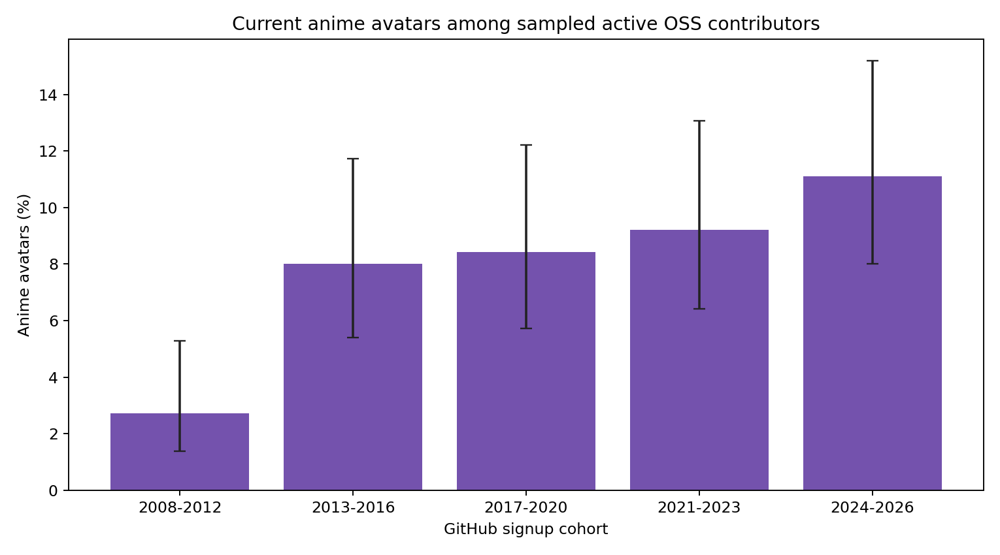
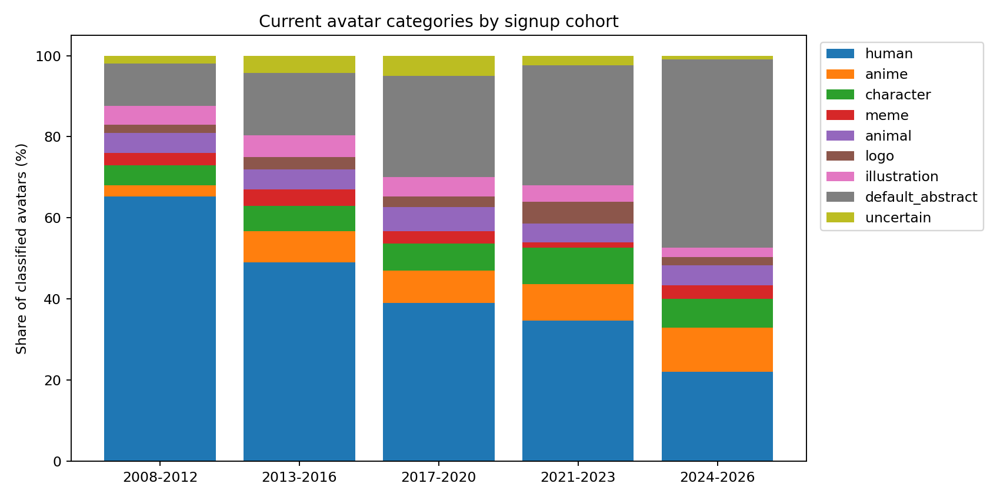

# GitHub 头像世代统计（第一版）

生成时间：2026-10-17T07:52:34.164231+00:00。研究对象是**所抽样的活跃开源贡献者**，不代表所有 GitHub 用户或程序员。

## 结果

主口径仅把 anime 计为二次元；另列 anime＋character 的宽口径，便于观察定义变化对结果的影响。

| 注册年份 | 入样人数 | 已分类 | 无法判断 | 二次元 / 可判断 | 比例 | 95% Wilson 区间 | 宽口径比例 |
|---|---:|---:|---:|---:|---:|---:|---:|
| 2008-2012 | 300 | 300 | 6 | 8 / 294 | 2.7% | 1.4–5.3% | 7.8% |
| 2013-2016 | 300 | 300 | 13 | 23 / 287 | 8.0% | 5.4–11.7% | 14.6% |
| 2017-2020 | 300 | 300 | 15 | 24 / 285 | 8.4% | 5.7–12.2% | 15.4% |
| 2021-2023 | 300 | 300 | 7 | 27 / 293 | 9.2% | 6.4–13.1% | 18.4% |
| 2024-2026 | 300 | 300 | 3 | 33 / 297 | 11.1% | 8.0–15.2% | 18.2% |

新组（2024–2026）与老组（2008–2012）的模型标注样本比例差为 **+8.4 个百分点**；两组 Wilson 区间端点相减为 +2.7 至 +13.8 个百分点，仅作描述参考，并非差值的正式置信区间。

## 人工标注子样本

每组从已入样账号中随机抽 30 张头像，由单人看未显示模型标签的拼图标注。小样本区间较宽，仅用于交叉核对模型趋势。

| 注册年份 | 人工二次元 / 抽查数 | 比例 | 95% Wilson 区间 | 宽口径 / 抽查数 |
|---|---:|---:|---:|---:|
| 2008-2012 | 0 / 30 | 0.0% | 0.0–11.4% | 3 / 30 |
| 2013-2016 | 3 / 30 | 10.0% | 3.5–25.6% | 3 / 30 |
| 2017-2020 | 3 / 30 | 10.0% | 3.5–25.6% | 8 / 30 |
| 2021-2023 | 2 / 30 | 6.7% | 1.8–21.3% | 3 / 30 |
| 2024-2026 | 1 / 30 | 3.3% | 0.6–16.7% | 8 / 30 |

人工抽查的严格二次元比例未呈现模型结果中的逐组上升：最新组仅 1/30，最早组为 0/30。每组只有 30 张，不能据此否定或确认总体趋势；预留评估集的二次元正例也很少，无法充分检验各世代的分类误差是否相同。因此，模型比例应视为探索性估计。

## 项目组成检查

### 仓库主语言

同一用户可能出现在多个组；这里只作偏差检查。

| 组别 | 老组可判断 | 老组二次元 | 新组可判断 | 新组二次元 | 新−老 |
|---|---:|---:|---:|---:|---:|
| Python | 58 | 1.7% | 109 | 8.3% | +6.5 pp |
| JavaScript | 27 | 3.7% | 13 | 7.7% | +4.0 pp |
| TypeScript | 57 | 1.8% | 71 | 11.3% | +9.5 pp |
| Go | 56 | 7.1% | 46 | 13.0% | +5.9 pp |
| Rust | 55 | 0.0% | 46 | 15.2% | +15.2 pp |
| Java | 42 | 2.4% | 17 | 17.6% | +15.3 pp |

### 仓库星数区间

同一用户可能出现在多个组；这里只作偏差检查。

| 组别 | 老组可判断 | 老组二次元 | 新组可判断 | 新组二次元 | 新−老 |
|---|---:|---:|---:|---:|---:|
| 50-499 | 41 | 4.9% | 39 | 15.4% | +10.5 pp |
| 500-4999 | 104 | 4.8% | 76 | 11.8% | +7.0 pp |
| 5000-50000 | 150 | 0.7% | 184 | 9.8% | +9.1 pp |

## 数据质量与局限

- 仓库数：360；采样窗口状态：{'complete': 1438, 'truncated': 2}；其中 468 个窗口没有默认分支提交。每窗口最多抓取 1,000 条；截断窗口：coleam00/Archon (2026-08-21), edwardkim/rhwp (2026-08-21)。
- 用户资料状态：{'eligible': 2144, 'error': 13, 'excluded': 13, 'selected': 1500}；头像下载状态：{'ok': 1500}；分类状态：{'ok': 1500}；有效模型标签：{'qwen3-vl:4b/two-stage': 1500}。
- 单人盲审标注：150 张（每组 30 张，拼图未显示模型标签）；预留的偶数编号 75 张中，二次元真阳性 6、误判为二次元 0、漏判 0（精确率 6/6，召回率 6/6）。
- 仓库按语言、星数分层，搜索结果和被抽中的项目仍有选择偏差；提交窗口也只覆盖过去一年的部分日期。
- 置信区间按独立用户计算，未消除同一仓库贡献者之间的相关性，仅用于描述抽样误差。
- 真人类别按照片外观判断，未核实是否为本人或 AI 生成。
- 注册年份是 GitHub 账号创建时间，头像是采集时的当前头像；这不是个人头像变化轨迹，也不能推断生理年龄。
